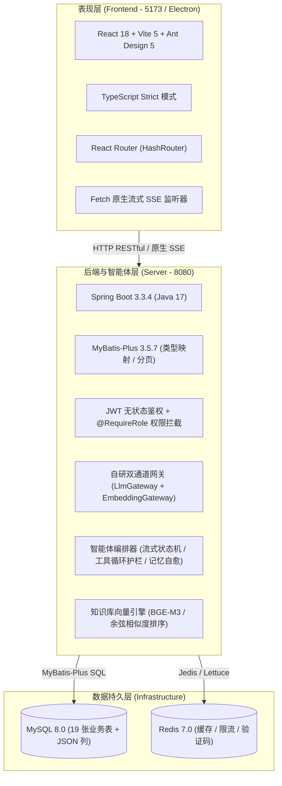
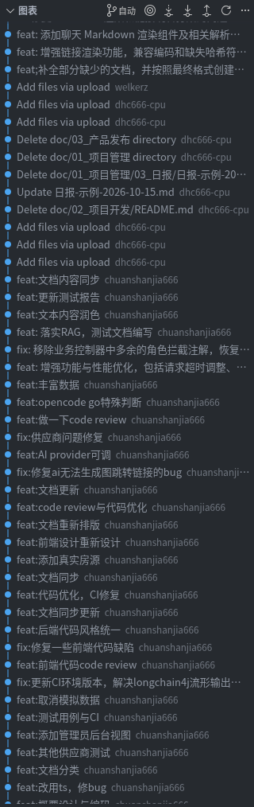

# RentAgent 编码记录与实现总结

| 项目 | 内容 |
| --- | --- |
| **项目名称** | RentAgent —— 基于 AI 智能体的房屋租赁系统 |
| **文档主题** | 06. 编码阶段实施记录、代码架构规范、版本演进与重构复盘 |
| **适用阶段** | 软件工程课程设计 —— 阶段四：编码与实现 |
| **编制日期** | 2026-10-23 |
| **开源地址** | 详细代码与内容查看：<https://github.com/chuanshanjia666/RentAgent> |
| **项目团队** | 王硕（项目负责人/后端核心）、邓颢琛（后端/AI架构）、张卫雨（前端主程）、陈玄晔（前端/质量测试）、李天泽（文档/数据工程） |

---

## 一、项目概述与编码目标

### 1.1 项目背景与定位
RentAgent 面向高校与青年群体，定位为“对话即服务（Conversation as a Service, CaaS）”房屋租赁平台。系统将房源检索、预约看房、合同签约、租金账单、评价申诉和内容审核等租赁业务与大语言模型智能体整合。用户既可以使用常规 Web/桌面界面操作业务，也可以通过多轮对话让智能体调用底层业务工具（Tool Execution）完成找房、咨询、预约和合同解读。

### 1.2 编码阶段总体目标
在完成需求定义、原型设计与概要设计评审后，编码阶段按设计基线推进，主要目标包括：
1. **全链路业务闭环**：实现租客端、房东端与管理端协同，完成实名认证、房源流转、预约时段防重、合同双签确认及账单生成的 P0 业务闭环；
2. **AI 网关自研与双通道解耦**：不依赖黑盒封装与本地规则模拟，自研适配 OpenAI Chat Completions、Anthropic Messages 和 OpenAI Responses 协议的客户端，并支持 LLM 与词嵌入（Embedding）通道独立配置与运行时热切换；
3. **流式智能体编排与护栏**：解决流式输出（SSE）中正文与工具调用（`tool_calls`）同轮并存时丢失调用的问题，设置单轮上限 8 次的收敛护栏与异常记忆清理机制；
4. **轻量稠密向量 RAG**：接入 BGE-M3 等词嵌入模型，实现平台知识库切片、向量存储、余弦相似度检索与相关度阈值过滤；
5. **工程质量门禁**：编写 269 条无外部网络和数据库依赖的单元测试，配合集成冒烟脚本与 CI 自动化流水线保障交付质量。

---

## 二、编码环境与技术栈基准

团队统一了开发运行环境与工具链版本，确保跨成员协作与持续集成环境的代码行为一致。

### 2.1 基础软件与运行环境
| 软件 / 组件 | 版本要求 | 作用与职责说明 |
| --- | --- | --- |
| **操作系统** | Linux (Ubuntu 22.04 LTS / Arch Linux) / macOS | 团队开发与 CI 运行系统 |
| **JDK** | 17 (Eclipse Temurin / OpenJDK 17.0.10) | 后端运行与编译环境（使用 Record、Pattern Matching 等特性） |
| **Maven** | 3.8.8+ | 后端依赖管理与构建工具 |
| **Node.js** | 18.20+ / 20.x LTS | 前端运行环境与包管理基座 |
| **MySQL** | 8.0.36 | 关系型数据库，字符集 `utf8mb4`，持久化 19 张业务表 |
| **Redis** | 7.2.4 (Alpine) | 验证码 TTL 暂存、登录防刷限流与高频缓存 |
| **Docker** | 24.0+ & Compose v2 | 基础设施容器化编排环境，统一本地与 CI 测试基底 |
| **Git** | 2.40+ | 版本控制与协作工具 |

### 2.2 核心技术栈架构选型


- **前端体系**：采用 React 18 + TypeScript + Vite 5 构建单页应用，引入 Ant Design 5 提供界面组件；路由选用 `HashRouter`，方便同一套构建产物打包为 Electron 40.10.2 桌面客户端；
- **后端体系**：采用 Spring Boot 3.3.4 与 MyBatis-Plus 3.5.7，使用 Java 17 的 `record` 定义不可变 DTO/VO，减少样板代码；
- **AI 与算法层**：基于自研 HTTP 客户端对接主流大模型接口；业务工具集（`HousingToolProvider`）与模型解耦，形成受控调用链路。

---

## 三、代码架构与编码规范约定

### 3.1 后端工程分层与控制反转原则
后端工程按整洁架构划分为四层：
1. **控制器层 (`controller/`)**：
   - 控制器只负责参数校验与流程编排，不编写业务分支、不拼装 SQL 实体、不直接调用 MyBatis-Plus Mapper；
   - 统一输出 `R<T>`（`{code, message, data}`）响应结构；业务错误统一抛出携带错误码的 `BizException(ErrorCode.X)`，由全局异常处理器捕获转换，不直接在控制器内返回错误。
2. **业务逻辑层 (`service/`)**：
   - 业务规则、属主校验（例如仅房东本人或管理员可编辑房源状态）、敏感信息加解密（身份证 AES-GCM / 哈希 SHA-256）和审计留痕均集中在 Service 层；
   - 列表接口强制采用服务端物理分页（返回 `PageVO{list, total, page, size}`），单页大小限制为 10～50，不在前端进行假分页。
3. **数据访问与实体层 (`mapper/`, `entity/`)**：
   - 针对 `house.facilities` 等动态数组列，使用 MyBatis-Plus 的 `@TableField(typeHandler = JacksonTypeHandler.class)` 与 `@TableName(autoResultMap = true)` 映射为 Java `List<String>`；
   - 数据库只保留统一数据格式，避免异构数据类型的冗余兼容逻辑。
4. **智能体编排与网关层 (`agent/`, `agent/gateway/`)**：
   - 遵循真实调用原则，未配置模型凭据或调用失败时返回错误码 `4001` 并附带具体原因，不做本地规则模拟或假回答；
   - 工具调用与自然语言流分离管理，单次响应全过程记录在 `ai_chat_message`（区分 role=1 用户 / role=2 助手 / role=3 工具调用留痕）。

### 3.2 前端工程规范与桌面端兼容原则
1. **TypeScript 严格模式**：开启 `strict: true`，禁止使用 `any` 绕过类型检查；类型声明统一集中在 `src/types.ts`，字段命名与后端 Record VO 保持一致；
2. **运行时地址隔离 (`src/runtime.ts`)**：
   - 桌面端 Electron 以 `file://` 协议加载页面，避免写死相对路径或绝对域名，所有请求由 `apiUrl()` / `assetUrl()` 统一拼接；
3. **统一请求封装 (`src/api.ts`)**：
   - Axios 请求拦截器注入 JWT，响应拦截器解包 `data` 并捕获业务错误；
   - 流式请求（SSE）基于原生 `fetch` 与 `ReadableStream` 编排，401 鉴权失效与登录重定向逻辑与常规 HTTP 请求保持一致；
4. **格式检查门禁**：
   - 统一代码格式（`semi: false`、`singleQuote: true`、`trailingComma: 'none'`、`printWidth: 100`），提交前运行 `npm run check`（包含 ESLint 检查、Prettier 格式校验与 Vitest 测试）。

### 3.3 数据库设计规约
- 19 张核心表均包含中文 `COMMENT` 注释、外键及索引约束；
- 主键统一采用 `BIGINT AUTO_INCREMENT`；
- 通用字段标准：业务表包含 `create_time` 与 `update_time`（`DEFAULT CURRENT_TIMESTAMP ON UPDATE CURRENT_TIMESTAMP`）；
- 涉及实名认证、房源审核和举报处理的写操作，联动写入 `audit_log` 审计日志表留痕。

---

## 四、版本控制与 Git 提交记录

项目采用 Git 进行版本控制，遵循语义化提交规范（Conventional Commits），代码提交记录记录了各阶段的演进。详细代码与内容查看：<https://github.com/chuanshanjia666/RentAgent>。

### 4.1 Git 提交规范
提交信息统一采用 `前缀: 中文说明` 格式：
- `feat:` 新增功能、页面组件或系统特性；
- `fix:` 修复功能缺陷、边界异常或接口契约不一致；
- `style:` 代码格式化、拼写调整、注释补充（不影响运行逻辑）；
- `refactor:` 代码结构优化、重构、组件拆分；
- `test:` 编写单元测试或补充集成断言；
- `docs:` 阶段成果物、设计文档及配置手册更新。

### 4.2 Git 提交历史图谱
项目开发期间的代码提交演进图如下：



> **图说明**：图谱记录了从最小可用原型搭建（2026-09-03）、核心业务实现、前后端联调、自研多协议网关落地、稠密向量 RAG 接入，到测试门禁验证与文档交付的提交过程。

### 4.3 代码量与工程统计
核心代码统计如下：

| 工程模块 | 文件数量 | 代码行数 (LOC) | 说明 |
| --- | --- | --- | --- |
| **后端主工程 (`server/src/main`)** | 115 个 Java 文件 | **10,791 行** | 控制器、业务逻辑、MyBatis 实体与 Mapper、安全拦截、大模型网关客户端、RAG 向量模块 |
| **后端单元测试 (`server/src/test`)** | 24 个测试类 | **5,520 行** | 237 条纯内存单元测试用例，覆盖状态机、协议转换与异常边界 |
| **前端工程 (`frontend/src`)** | 40 个 TS/TSX 文件 | **7,540 行** | 租客端、房东端、管理端页面、Markdown 渲染、路由与 API 契约 |
| **数据库初始化脚本 (`docker/mysql-init`)** | 1 个 SQL 文件 | **720 行** | 19 张业务表 DDL 定义、中文注释与预置初始字典 |
| **自动化测试与冒烟 (`scripts/`)** | 3 个 Shell 脚本 | **680 行** | 158 条集成接口冒烟断言、6 条无模型反向门禁测试脚本 |
| **总计** | **183 个核心源文件** | **25,251 行** | **核心源文件总代码量（不含外部依赖库与构建产物）** |

### 4.4 关键提交日志（Commit Log）全景回溯

下表汇总了项目开发中的关键提交节点：

| 提交哈希 | 提交日期 | 提交人 | 提交类型与摘要 | 对应工作内容 |
| --- | --- | --- | --- | --- |
| `0a05b8a` | 2026-09-03 | chuanshanjia666 | `Initial commit` | 仓库初始化，创建基础目录结构 |
| `688d33e` | 2026-09-04 | chuanshanjia666 | `feat: 构建最小原型系统` | 搭建初始前后端交互骨架与页面路由 |
| `5c24d22` | 2026-09-14 | chuanshanjia666 | `feat:概要设计与编码` | 确立 19 张表 DDL，生成 MyBatis-Plus 基础代码 |
| `925a6b7` | 2026-09-15 | chuanshanjia666 | `feat:改用ts，修bug` | 前端迁移至 TypeScript 严格模式，修复隐式 any |
| `7636148` | 2026-09-17 | chuanshanjia666 | `feat:其他供应商测试` | 展开多大模型接口兼容性测试与连通验证 |
| `9d1349d` | 2026-09-17 | chuanshanjia666 | `feat:添加管理员后台视图` | 交付管理端审核工作台、数据看板与系统配置页 |
| `e762335` | 2026-09-17 | chuanshanjia666 | `feat:取消模拟数据` | 移除 Mock 假数据，切换为真实数据库与 API 通信 |
| `1eb9196` | 2026-09-17 | chuanshanjia666 | `fix:更新CI环境版本，解决longchain4j流形输出导致的截断问题` | 修复流式传输截断问题，提升流式长文本稳定性 |
| `449bec0` | 2026-09-18 | chuanshanjia666 | `feat:后端代码风格统一` | 控制器精简为流程编排，业务逻辑下沉至 Service |
| `9bc93f8` | 2026-09-18 | chuanshanjia666 | `feat:代码优化，CI修复` | 引入 Prettier 与 ESLint 检查门禁，配置 CI 流水线 |
| `4bc00e5` | 2026-09-21 | chuanshanjia666 | `feat:code review与代码优化` | 实施第二轮代码审查，增加并发签约保护与工具死循环护栏 |
| `1d263a5` | 2026-09-22 | chuanshanjia666 | `fix:修复ai无法生成图跳转链接的bug` | 修复前端由于路由哈希判定错误导致房源卡片无法跳转问题 |
| `7593626` | 2026-10-13 | chuanshanjia666 | `feat:AI provider可调` | 开发 AI 供应商配置模块，支持在后台动态切换模型 |
| `3d2b645` | 2026-10-14 | chuanshanjia666 | `fix:供应商问题修复` | 修复不同模型对 System Prompt 和 temperature 参数的兼容问题 |
| `a0a9835` | 2026-10-14 | chuanshanjia666 | `feat:做一下code review` | 第三轮代码评审：规范异常错误码分段，清理未引用代码 |
| `298fe28` | 2026-10-14 | chuanshanjia666 | `feat:opencode go特殊判断` | 针对特定聚合网关及模型响应格式进行容错解析 |
| `4f27f24` | 2026-10-16 | chuanshanjia666 | `fix: 移除业务控制器中多余的角色拦截注解，恢复集成冒烟接口契约` | 修正控制器多余的角色拦截，恢复冒烟测试接口契约 |
| `e6da442` | 2026-10-16 | chuanshanjia666 | `feat: 增强功能与性能优化，包括请求超时调整、图表更新逻辑及异常处理` | 优化图表更新逻辑，按轮次动态计算网关超时时长 |
| `394a404` | 2026-10-20 | chuanshanjia666 | `feat: 落实RAG，测试文档编写` | 落地稠密向量 RAG 体系（接入 BGE-M3 与余弦检索），单测增至 237 条 |
| `0d2566b` | 2026-10-26 | chuanshanjia666 | `feat: 添加聊天 Markdown 渲染组件及相关解析功能，支持安全链接和多种 Markdown 语法` | 前端增加 Markdown 渲染组件，支持安全链接解析与流式排版 |
| `80daa71` | 2026-10-26 | chuanshanjia666 | `fix:修复markdown渲染和链接跳转打架的问题` | 解决组件事件冒泡冲突，确保点击房源卡片平滑跳转 |

---

## 五、编码演进历程与核心模块实现

整个编码周期历经四周半，分为四个迭代阶段进行推进。

### 5.1 迭代一：基础设施搭建与最小原型系统（2026-09-03 ～ 2026-09-14）
- **数据库设计与落地**：编写并验证 `01_schema.sql`，建立用户表（`sys_user`）、房源表（`house`）、图片表（`house_image`）、预约表（`viewing_appointment`）、合同表（`contract`）等 19 张表；
- **身份认证与权限控制**：
  - 基于 `io.jsonwebtoken` 实现无状态 JWT 生成与校验过滤器（`JwtAuthenticationFilter`）；
  - 设计 `@RequireRole` 注解与拦截器，支持租客（`ROLE_TENANT`）、房东（`ROLE_LANDLORD`）与管理员（`ROLE_ADMIN`）三类角色权限划分；
  - 密码使用 BCrypt 加密存储；身份证号采用 AES-GCM 加密，并保留 SHA-256 哈希值用于唯一性校验；
- **前端脚手架**：代码全面重构为 TypeScript 严格模式，使用 Ant Design 5 搭建基础布局与通用路由。

### 5.2 迭代二：租赁业务全链路闭环（2026-09-15 ～ 2026-09-21）
- **房源状态流转**：
  - 实现房源“草稿/待审核（0）→ 审核通过（1）→ 审核驳回（2）→ 已出租（3）→ 下架（4）”状态机；
  - 开发多条件找房页面，支持按户型、租金区间、区域和配套设施筛选；
- **看房预约冲突排他**：
  - 租客端发起看房预约时，校验时间不能为过去时间，且同一房源同一时段只保留一份有效预约（`status = PENDING/CONFIRMED`）；
  - 房东端支持确认或驳回预约，驳回需填写理由并向租客推送站内通知；
- **电子合同与租金账单**：
  - 实现房东与租客双重签署流程；
  - 合同生效后（`status = ACTIVE`），系统按租期、月租金及押金额度生成首期与后续各期租金账单（`rent_bill`）；
  - 采用乐观条件更新防止并发重复签署（`UPDATE contract SET status = ... WHERE id = ? AND status = ?`）。

### 5.3 迭代三：自研多协议 AI 网关与流式工具编排（2026-09-22 ～ 2026-10-14）
- **多协议适配器实现**：
  - 自研 `OpenAiChatCompletionsModel`、`AnthropicMessagesChatModel` 与 `OpenAiResponsesChatModel`；
  - 根据模型类型自动切换请求参数：经典模型使用 `max_tokens` 与 `temperature`，推理型模型（如 o 系列、DeepSeek 推理模式）使用 `max_completion_tokens`，避免参数校验报错；
- **双通道解耦管理体系**：
  - 设计 `ai_provider_config` 表结构，支持大语言模型（LLM）与词嵌入模型（EMBEDDING）分别配置端点路径、密钥、模型名称与超时时长；
  - 管理后台提供可视化配置页面，支持随时切换生效提供商并支持 Ping 连通性测试，修改后即时生效无需重启服务；
- **流式工具编排与护栏**：
  - 在 `HousingToolProvider` 中实现 `searchHouses`、`getHouseDetail`、`createAppointment` 等 8 项业务工具；
  - 设定单轮工具调用上限（8 次），避免出现调用死循环，保证流式文本平滑输出。

### 5.4 迭代四：稠密向量 RAG 体系与富文本交互（2026-10-15 ～ 2026-10-22）
- **稠密向量知识库**：
  - 接入 BGE-M3 嵌入模型，文档导入时自动切片并生成 1024 维特征向量；
  - 实现基于内存向量的余弦相似度检索，设置相关度阈值过滤无关切片，提升租赁规则问答召回质量；
- **Markdown 引擎与安全链接解析**：
  - 前端开发定制 Markdown 渲染组件，支持安全链接解析；
  - 将 AI 回复中的 `[标题](#/app/houses/{id})` 渲染为可交互的站内房源卡片，点击可直接进入房源详情。

---

## 六、关键技术难点攻关与代码审查重构记录

在编码过程中，团队通过 4 轮代码审查（Code Review）重构了以下关键技术点：

### 6.1 攻关点 1：流式 SSE 输出中正文与 Tool Calls 同轮并存丢调用
- **问题现象**：部分模型在回答复杂找房请求时，会先输出一段自然语言（如“正在为您查找海淀区的房源...”），紧接着在后续分片中发起 `tool_calls`。部分开源适配层在接收到开头的文本内容后，便判定当前轮为纯文本流，忽略后续分片中的工具调用，导致工具无法触发。
- **解决方案与实现代码**：
  实现双通道累加状态机。对到来的每个 SSE 分片，分别处理 `content` 与 `tool_calls`，保持两个收集容器独立累积：
  ```java
  // 正文通道与工具通道分别累积，在 finish_reason 到达后合并
  if (delta.content() != null) {
      contentBuilder.append(delta.content());
      handler.onNext(delta.content()); // 实时下发至前端 SSE，保障低延迟输出
  }
  if (delta.toolCalls() != null) {
      for (ToolCallChunk chunk : delta.toolCalls()) {
          // 按 call_index 拼装工具名称与 arguments 参数 JSON
          accumulateToolCallChunk(chunk);
      }
  }
  ```
  在检测到流结束时，将累积的完整正文与解析后的 `ToolExecutionRequest` 共同封装为完整的 `AiMessage`，恢复完整的工具调用链路。

### 6.2 攻关点 2：智能体调用死循环护栏与上下文自愈
- **问题现象**：模型在特定边界下可能频繁使用微调后的参数重复调用工具，导致单次请求长时间挂起并消耗过多 Token。
- **解决方案与实现代码**：
  在 `HousingToolProvider` 中引入单轮计数器：
  1. 单轮工具调用达到 8 次时，工具提供器拦截后续执行，向模型返回终止提示：“工具调用次数已达上限，请根据已有数据直接总结回答”；
  2. 若模型在收到提示后依然发起工具调用，抛出 `ToolCallLimitExceededException` 终止本轮；
  3. **记忆自愈清理**：发生异常终止时，`LlmAgent` 会清除本轮对话记忆（若保留包含 `tool_calls` 但缺少工具结果的消息，后续请求会被大模型 API 以 400 状态码拒绝）。

### 6.3 攻关点 3：电子合同签署并发安全与防重
- **问题现象**：网络抖动或连续重复点击可能导致针对同一份合同提交多次签署请求，极端情况下可能派生出重复的租金账单。
- **解决方案与实现代码**：
  在 `ContractServiceImpl` 中使用“CAS 条件更新 + 状态约束”机制：
  ```java
  // 乐观 CAS 条件更新：仅在合同状态处于待签署时才允许流转
  LambdaUpdateWrapper<Contract> wrapper = new LambdaUpdateWrapper<Contract>()
      .eq(Contract::getId, contractId)
      .eq(Contract::getStatus, ContractStatus.PENDING_LANDLORD.getCode())
      .set(Contract::getStatus, ContractStatus.ACTIVE.getCode())
      .set(Contract::getLandlordSignTime, LocalDateTime.now());
  boolean updated = contractMapper.update(null, wrapper) > 0;
  if (!updated) {
      throw new BizException(ErrorCode.CONTRACT_STATUS_INVALID, "合同状态已变更，请刷新后重试");
  }
  // 仅在 CAS 成功更新影响行数为 1 时，触发账单生成逻辑
  billService.generateBillsForContract(contract);
  ```

---

## 七、单元测试与自动化质量门禁记录

项目推行“提交必须过门禁”的开发规范，建立了前端语法格式校验、后端单元测试与全链路接口冒烟的测试机制。

### 7.1 单元测试覆盖情况
全工程单元测试共计 **269 个测试用例**，均不依赖外部网络、MySQL 或 Redis 实例，全部在内存中运行：

| 测试类目 | 用例数量 | 代表测试类 | 覆盖内容与断言重点 |
| --- | --- | --- | --- |
| **后端协议与网关** | 35 条 | `OpenAiChatCompletionsModelTest`, `OpenAiResponsesChatModelTest`, `JsonSchemasTest` | 请求路径拼接、SSE 分片解析、双通道合并、推理模型 token 参数适配 |
| **智能体与工具执行** | 22 条 | `HousingToolProviderTest`, `LlmAgentTest`, `ChatServiceTest` | 工具调用收敛（8 次上限）、异常记忆自动清理、动态超时计算、身份传递 |
| **向量检索与 RAG** | 15 条 | `EmbeddingGatewayTest`, `OpenAiEmbeddingClientTest`, `KbServiceTest` | BGE-M3 向量编解码、余弦相似度计算与边界、阈值过滤与降级 |
| **业务核心状态机** | 165 条 | `HouseServiceTest`, `ContractServiceTest`, `AppointmentServiceTest`, `AuthServiceTest` | 角色鉴权、房源上下架、预约时段防重、并发签署防重、账单生成与校验 |
| **前端单测与组件** | 32 条 | Vitest + JSDOM (`chatLinks.test.ts`, `api.test.ts`) | 流式 SSE 解析容错、Markdown 安全跳转、路由哈希参数捕获 |
| **合计** | **269 条** | **全部通过（100% Pass）** | **业务逻辑与异常边界覆盖** |

### 7.2 集成接口冒烟与门禁断言
集成测试阶段使用自动化脚本进行接口校验：
- **全链路冒烟脚本 (`ci-smoke.sh`)**：覆盖注册、登录、实名认证、房源流转、审批、预约、签约、账单及智能体问答等 25 个场景，包含 **158 条硬性接口断言**；
- **反向无模型门禁 (`ci-no-model-check.sh`)**：启动无 AI 凭据的后端实例，验证未配置模型时系统如实返回错误码 `4001`，且常规租赁业务不受影响，共 **6 条反向断言**；
- **本地与 CI 校验流程**：提交前在本机运行：
  ```bash
  cd server && mvn test             # 后端 237 条单测
  cd ../frontend && npm run check   # 前端 ESLint + Prettier + Vitest 32 条
  bash scripts/ci-smoke.sh          # 158 条集成接口冒烟
  ```

---

## 八、编码阶段总结与团队体会

编码阶段的实践沉淀了以下几点体会：

1. **契约优先降低联调成本**：
   在编码前期确立了数据库字典与前后端 RESTful 接口规约（统一错误码分段、不可变 VO 载体），避免了后期联调中的字段不一致问题，保障了前后端并行开发进度；
2. **针对真实问题自研核心链路**：
   在对接大模型与智能体过程中，团队针对开源框架在流式分片丢失工具调用、死循环缺少护栏等具体问题，自主实现了多协议适配网关、双通道收集状态机与轻量稠密向量 RAG，满足了“对话即服务”在真实业务场景中的可用性与稳定性；
3. **测试门禁保障工程稳定性**：
   严格执行提交格式规范、静态语法检查与单元测试门禁，全工程 269 条单元测试和 158 条集成断言为系统重构与快速迭代提供了安全屏障，保证了系统交付的可靠性。
