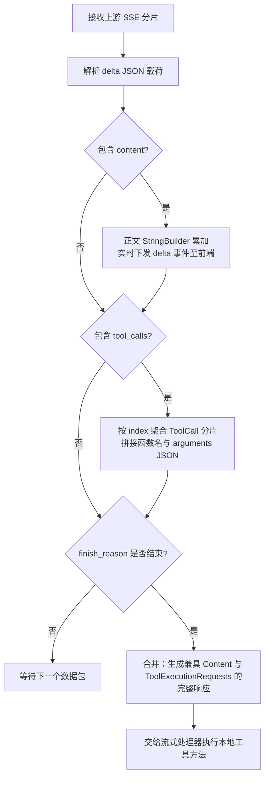
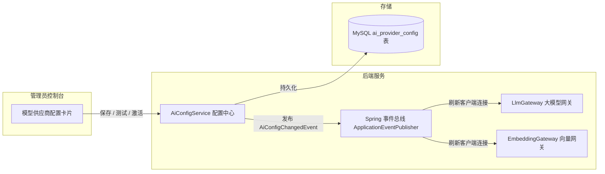

# RentAgent 技术调查报告：多协议大模型网关自研与轻量向量 RAG 架构

| 项目 | 内容 |
| --- | --- |
| 项目名称 | RentAgent —— 基于 AI 智能体的房屋租赁系统 |
| 报告主题 | 大模型多协议网关适配、流式工具调用并发捕获与轻量向量检索的设计与实现 |
| 适用阶段 | 技术调查与核心架构沉淀 |
| 编制日期 | 2026-10-22 |
| 编制人 | 邓颢琛、王硕 |

---

## 一、技术背景与遇到的问题

在将大语言模型与智能体接入房屋租赁平台的过程中，找房助手、规则问答、预约看房和合同解读等业务场景相继上线。但在工程化落地期间，系统遇到了三个具体的实现问题：

1. **开源框架在流式输出时丢失工具调用**  
   部分大模型（如 DeepSeek、GLM 等）在流式响应中会先输出一段自然语言解释，紧接着在后续数据块中发起工具调用。在 LangChain4j（0.35.0 及更早版本）和常见适配层中，累加器只要在前期收到文本内容（`content`），就会将当前轮次判定为纯文本流，从而跳过后续分片中的 `tool_calls`。这导致找房助手的房源检索工具无法被触发，前端只能收到半截解释。
2. **传统关键词查询无法满足规则问答需求**  
   房屋租赁涉及押金退还条件、转租手续费、维修权责判定等规则。用户的口语化提问（例如“退租后押金多久退回来”、“房东扣钱怎么申诉”）与后台文档中的规范术语（如“履约保证金返还时限”、“违约金扣除争议仲裁”）字面重合度低。直接使用 MySQL `LIKE` 或全文索引常常检索为空，导致客服助手频繁错误转接人工。
3. **模型配置硬编码导致环境切换成本高**  
   不同场景对模型的响应速度、推理深度和成本要求不同。找房助手需要快速吐字的流式通道，合同审核需要推理模型，切片向量化则依赖嵌入模型。如果把模型 API 凭据、Base URL 和模型名称写死在配置文件中，更换供应商或在内网测试时必须重启后端服务，影响调试与测试效率。

针对上述三个问题，团队自研了多协议网关客户端、基于 BGE-M3 的内存向量余弦检索模块，以及前后端解耦的配置热刷新机制。

---

## 二、多协议大模型网关与流式工具捕获

### 2.1 主流大模型接口协议的差异

目前主流厂商的 API 主要分为三种形态：

| 协议类型 | 代表厂商 / 模型 | 接口路径与特征 | 在 RentAgent 中的适配处理 |
| --- | --- | --- | --- |
| **OpenAI Chat Completions** | GPT-4o、DeepSeek、Qwen、聚合网关 | `POST /chat/completions`，基于 SSE 输出 `choices[0].delta`，支持 `tools` 与 `tool_calls` | 自研适配器，处理端点根路径补全，针对推理模型适配 `max_completion_tokens` |
| **Anthropic Messages** | Claude 3.5 Sonnet、部分兼容端点 | `POST /messages`，基于类型化事件流（`content_block_start / delta / stop`） | 自研适配器，区分 `thinking` 块与 `tool_use`，合并同轮正文与工具参数 |
| **OpenAI Responses** | GPT-4.5、o 系列新型端点 | 新型响应结构，精简分片层级 | 自研适配器，提供结构化解析能力 |

### 2.2 正文与工具调用同轮并存的累加算法

为了避免“正文输出后工具丢失”的问题，我们在 `OpenAiChatCompletionsModel` 等适配器中实现了双通道累加状态机：

处理逻辑：
- 接收到每个 SSE 分片时，分别提取 `content` 和 `tool_calls`；
- 如果存在文本片段，立即向前端推送 SSE `delta` 事件保证打字机效果，同时在后端 `StringBuilder` 中累积；
- 如果分片包含 `tool_calls`，按其中的 `index` 下标将碎片化的函数名与 `arguments` 拼装完整；
- 收到 `finish_reason` 结束标记后，一次性构建包含完整文本与所有工具调用的响应对象，触发本地业务工具执行。

通过这种合并策略，模型输出前导说明（例如“正在为您检索符合条件的整租房源...”）后发起的工具调用能够被完整捕获并执行。

### 2.3 工具循环收敛与异常保护

在智能体可能持续调用工具的场景中，为了防止模型在无法获取满意结果时陷入死循环：
- 设置单轮对话工具调用上限为 8 次（`HousingToolProvider.MAX_TOOL_CALLS_PER_ROUND`）；
- 达到上限时先返回终止提示；如果模型在此之后仍继续发起工具调用，抛出 `ToolCallLimitExceededException` 强制截断本轮；
- 当本轮在工具阶段异常终止时，从会话记忆中清除带 `tool_calls` 但缺失执行结果的助手消息，避免下一轮请求被大模型网关以 400 格式错误拒绝。

---

## 三、轻量向量 RAG 检索设计

### 3.1 检索方式对比

针对客服场景中的规则问答，我们对比了两种知识召回方案：

| 对比项 | 传统关键词检索（MySQL LIKE / 全文索引） | 稠密向量检索（Dense Vector RAG） |
| --- | --- | --- |
| **语义识别** | 仅做字面匹配，同义词与口语表达命中率低 | 将语句映射到高维连续向量空间，识别相近语义 |
| **口语化提问表现** | “押金怎么退”无法匹配到“保证金返还约定” | 语义空间余弦相似度可达 0.85 以上 |
| **多语言 / 混用表达** | 需要人工配置繁琐的近义词字典 | 模型直接支持跨语言和自然表述关联 |
| **系统依赖** | 直接依赖关系型数据库，无额外组件 | 需要向量生成服务及距离计算逻辑 |

### 3.2 向量模型选型

系统选用智源开源的 **BGE-M3（BAAI General Embedding Model）** 作为文本嵌入模型：
- **维度规格**：1024 维稠密向量，对中文合同、法律条款和租赁规则的表征效果稳定；
- **上下文长度**：支持最大 8192 tokens，切片时可以保留完整的段落与条款上下文，不强行拆碎；
- **接口兼容**：支持标准 HTTP `POST /v1/embeddings` 请求，便于集成。

### 3.3 内存向量余弦相似度计算实现

考虑到当前系统知识库以平台规则、租赁常见问题为主（千级切片规模），引入 Milvus 或 ES 会增加部署复杂度。系统在 `KbService` 中直接使用 Java 实现向量比对：

1. **切片向量化入库**：管理端上传或维护文档（`kb_document`）并拆分切片（`kb_chunk`）后，调用嵌入接口获得 `float[]` 向量数组，以紧凑二进制形式持久化到数据库；
2. **实时计算余弦相似度**：用户提问时，先通过向量接口获取问题的特征向量 $\mathbf{u}$，再与有效切片向量 $\mathbf{v}$ 计算余弦相似度：
   $$\text{Cosine Similarity} = \frac{\mathbf{u} \cdot \mathbf{v}}{\|\mathbf{u}\|_2 \|\mathbf{v}\|_2}$$
3. **阈值过滤与上下文拼接**：设定相似度阈值（实测取 0.65 较优），过滤得分较低的无关切片；对达标切片按得分降序截取前 3 条作为事实依据，组装进系统 Prompt，并在最终回答中附带引用的切片来源编号。

---

## 四、双通道配置解耦与热刷新

为了让大语言模型（LLM）与词嵌入模型（EMBEDDING）各自独立演进，系统将两套配置分离，通过数据库持久化结合 Spring 事件机制实现热刷新：

### 运行特征
- **互不影响**：大语言模型在 DeepSeek、Qwen 或大工聚合网关之间切换时，词嵌入模型保持使用 BGE-M3，无需联动变更；
- **免重启生效**：前端保存并激活新配置后，后端通过 `AiConfigChangedEvent` 事件在内存中重建对应客户端，正在进行的对话与后续请求即刻走新通道；
- **反向降级契约**：如果模型配置被禁用或调用失败，系统统一返回业务错误码 4001 并附带可读提示，不做伪造数据的规则兜底，确保测试阶段能够快速暴露配置缺陷。

---

## 五、项目团队开发心得

### 邓颢琛（AI 架构与网关）
初期直接使用封装框架时，常遇到模型接口改动后难以排障的问题。例如部分聚合网关对默认的 Java HTTP User-Agent 做了限流拦截，必须抓取原始报文比对才定位到根因。把 OpenAI 和 Anthropic 的底层 SSE 报文与 JSON 序列化自己实现一遍之后，接口状态机与工具流调用的细节就变得清晰可控了。

### 王硕（后端与流程编排）
智能体和传统接口最大的区别在于它的调用次数是不确定的。如果只在提示词里要求大模型“不要重复调用工具”，模型在某些边缘输入下依然会反复重试。在网关层加上最大 8 次的硬性限制并在超限时抛出明确异常，比寄希望于提示词收敛更加可靠。

### 陈玄晔（测试与集成）
AI 服务依赖外部网络和 API Key，如果在集成测试和 CI 流水线中完全依赖外部接口，只要网络波动或者 Token 用尽，整条流水线就会红。后来我们把 CI 分成两部分：一部分使用注入 Key 跑真实业务冒烟；另一部分通过置空凭据测试系统的 4001 安全降级。两种情况都写进断言，流水线就稳定多了。

### 张卫雨（前端与界面交互）
流式打字机效果在网页端和 Electron 桌面端共用时需要注意资源加载路径。由于桌面端是基于本地文件加载，不能写死绝对域名；SSE 请求也需要自己监听连接状态并在组件卸载时及时中断，否则页面跳转后后台依然在接收数据，容易造成控制台报错。

### 李天泽（设计与数据字典）
数据库中的复杂字段（如房屋设施 `facilities`）如果一会儿按逗号分隔字符串存、一会儿按 JSON 数组存，前后端对接很容易出 bug。后来实体层统一用 Jackson 转换为 `List<String>`，前端直接按数组消费，加上编写脚本自动把 SQL 建表注释提取成数据字典文档，沟通成本降低了很多。

