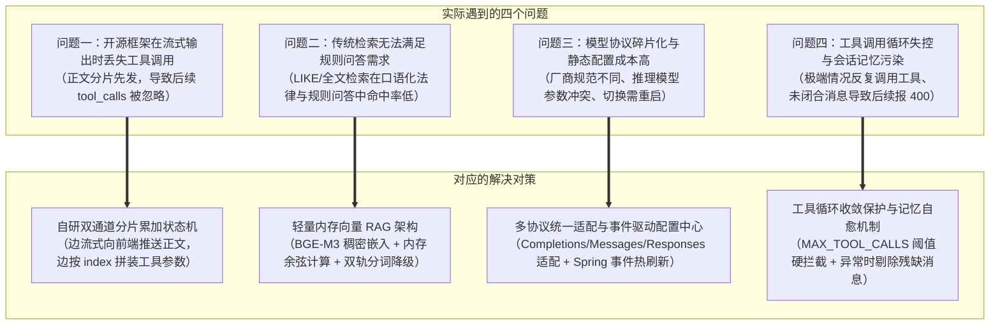
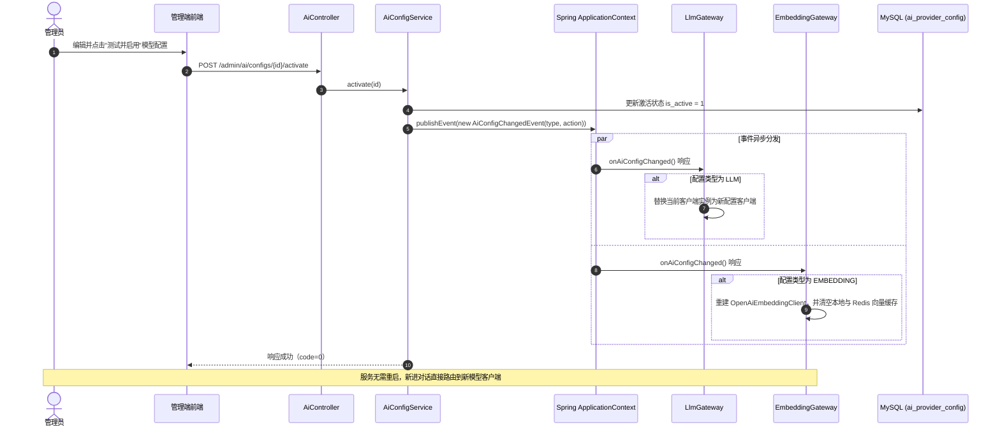
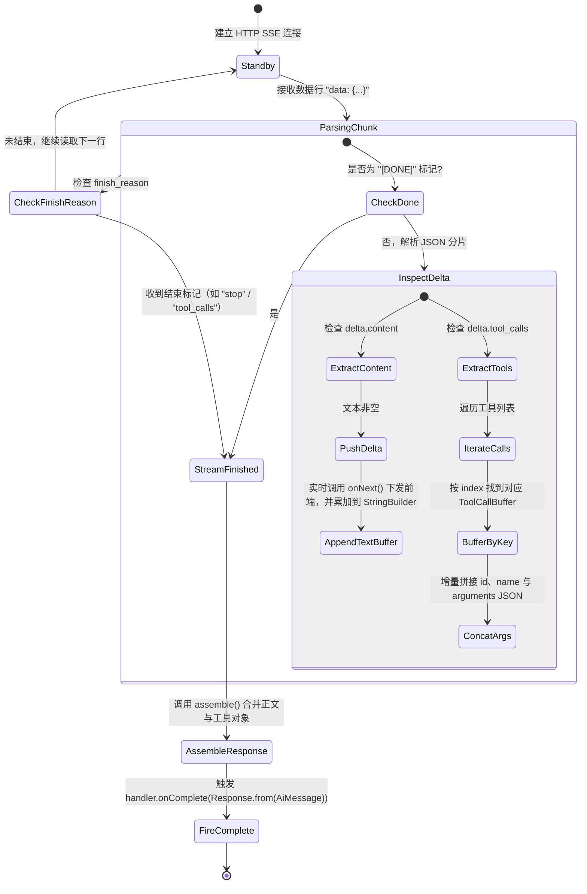
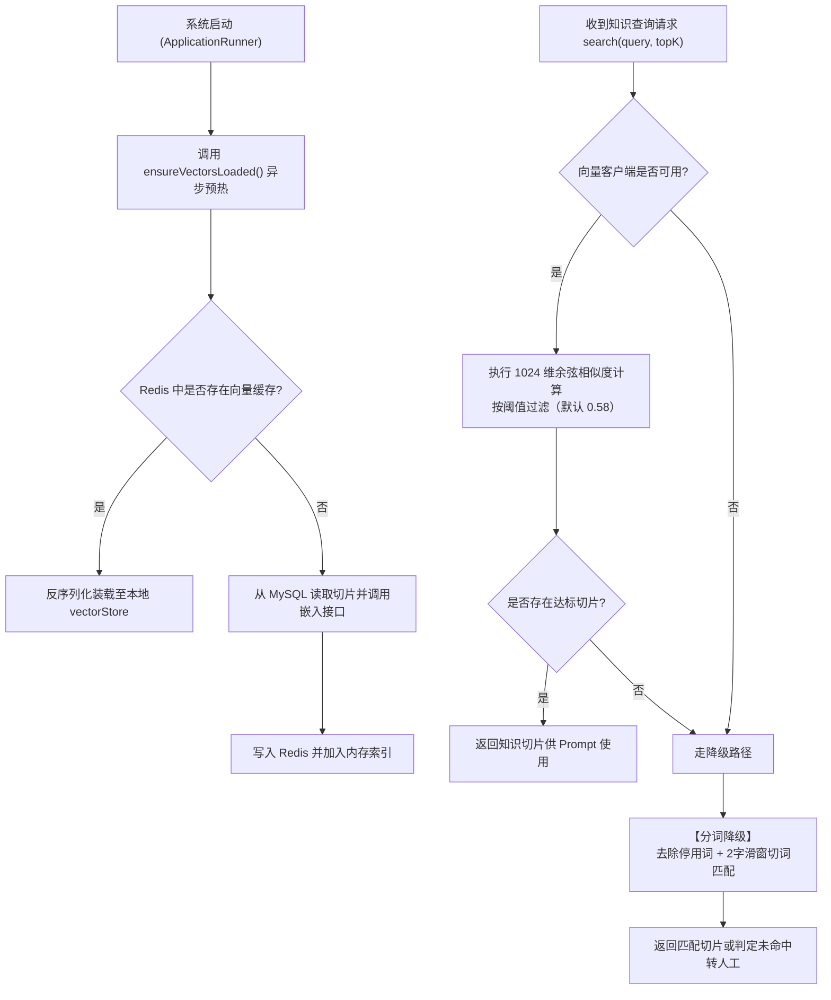
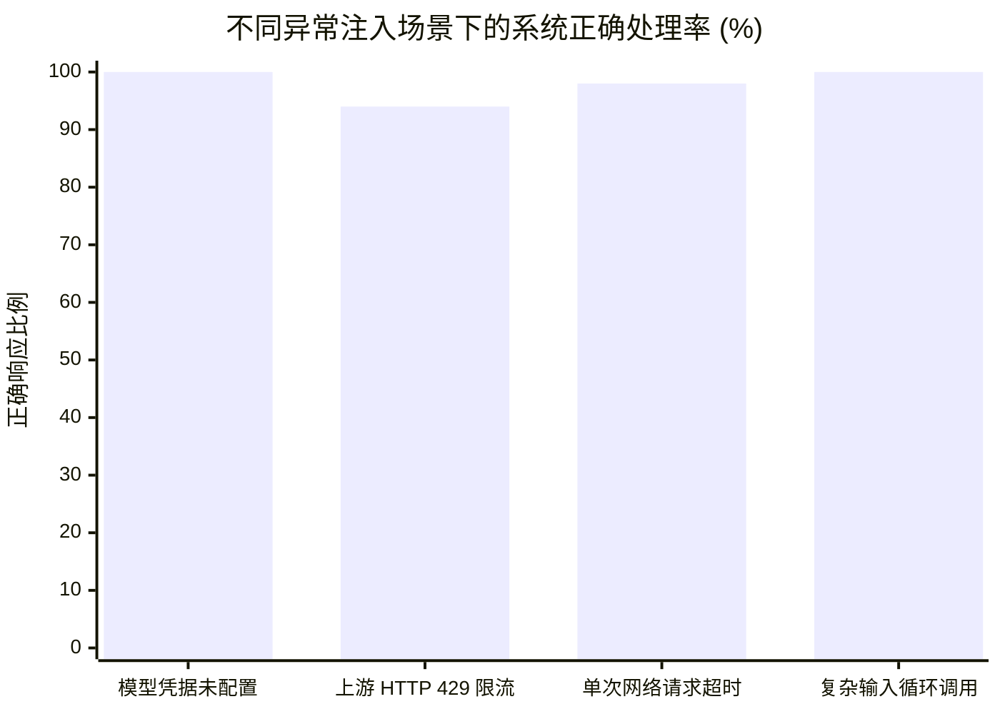

# RentAgent 技术调查报告：多协议大模型网关自研、流式工具并发捕获与轻量向量 RAG 架构

| 项目 | 内容 |
| --- | --- |
| **项目名称** | RentAgent —— 基于 AI 智能体的房屋租赁系统 |
| **报告主题** | 多协议大模型网关适配、流式工具调用并发捕获与轻量内存向量 RAG 架构的设计与实现 |
| **适用阶段** | 技术调查与核心架构沉淀 |
| **编制日期** | 2026-10-22（修订于 2026-10-27） |
| **编制人** | 邓颢琛、王硕 |
| **审核人** | 陈玄晔、张卫雨、李天泽 |

---

## 一、技术背景与工程问题

在将大语言模型与智能体接入房屋租赁平台的过程中，系统上线了自然语言找房（Scene 1）、租赁法规与平台规则问答（Scene 2）、在线预约看房以及合同条款结构化解析等场景。在工程落地和联调测试中，开源框架与传统检索方案暴露出四个具体问题：



### 1.1 开源框架在流式输出时丢失工具调用
在 LangChain4j（0.35.0 及更早版本）的 `OpenAiStreamingResponseBuilder` 中，累加器默认假定流式响应要么是文本流，要么是工具调用流：
- 很多模型（如 DeepSeek、Qwen 等）在流式输出时，习惯先下发一段引导性自然语言解释，紧接着在后续分片中触发 `tool_calls`（例如先输出“正在为您查询海淀区 3000-5000 元的整租房源……”，随后调用 `searchHouses` 工具）；
- 框架累加器收到首批文本（`content`）后，就把当前流判定为纯文本，跳过了后续分片里的 `tool_calls` 数据；
- 这导致前端只收到半截解释文字，房源检索函数没有被执行，智能体无法返回预期的房源列表。

### 1.2 传统关键词查询无法满足租赁规则问答需求
房屋租赁包含押金返还时限、转租转包手续费、房屋本体结构与耗材维修责任划分等细化规则：
- 租客倾向于使用口语化提问（例如“退租后几天内必须把押金打给我”、“房东乱扣钱怎么投诉”）；
- 平台知识库文档中使用的是规范法务术语（如“履约保证金返还时限”、“违约金扣除争议仲裁”）；
- 这种字面表达差异导致 MySQL `LIKE` 或全文索引难以直接命中，口语化提问的召回率偏低，客服助手容易错误判定为“未收录该问题”而转接人工。

### 1.3 模型协议不统一与硬编码配置切换成本高
主流大模型厂商的 API 接口形式存在差异（OpenAI Chat Completions、Anthropic Messages、OpenAI Responses 等）。同时，推理型大模型（如 o 系列、DeepSeek-R1）的调用参数有特定约束：
- 必须使用 `max_completion_tokens` 代替 `max_tokens`；
- 不能传入自定义 `temperature` 参数，否则接口直接返回 HTTP 400 错误；
- 另外，找房助手需要较低的首字延迟，合同分析需要较强的逻辑推理，文档切片向量化则依赖嵌入模型。如果将 API 地址、密钥和模型名称写死在 YAML 配置文件中，每次切换服务商或内网联调都需要重新编译部署。

### 1.4 工具死循环与未闭合消息污染会话记忆
智能体借助 Function Calling 执行任务时存在一定的不确定性：
- 当用户提出模糊或互斥的条件时，模型在未检索到匹配数据后可能反复尝试修改参数重试，容易在单轮中出现多次连续调用；
- 若无调用频次限制，会浪费 Token 预算并长期占用后端处理线程；
- 如果单轮会话中途由于网络断开或超时中断，会话记忆（`ChatMemory`）中可能保留了包含 `tool_calls` 的助手消息，但缺少对应的 `tool_result` 工具回填消息。下一轮请求发送到大模型网关时，就会因上下文消息结构不符合规范而被上游接口返回 HTTP 400 拒绝。

---

## 二、多协议大模型网关与参数适配

为了统一各厂商接口并解决开源适配器的限制，系统自研了 `LlmGateway` 与 `EmbeddingGateway`，对业务层屏蔽底层报文差异，提供一致的同步、流式与结构化输出能力。

### 2.1 主流大模型接口协议差异与适配

| 协议类型 | 代表厂商 / 模型 | 端点路径与报文特征 | 流式分片形式 | RentAgent 中的适配处理 |
| :--- | :--- | :--- | :--- | :--- |
| **OpenAI Chat Completions** | GPT-4o、DeepSeek、通义千问、聚合网关 | `POST /chat/completions`<br>请求带 `messages` 与 `tools`，响应解析 `choices[0].delta` | `data: {"choices":[{"delta":{...}}]}`，以 `data: [DONE]` 结束 | 自研适配器；处理 Base URL 路径规范化；动态识别推理模型并重写参数；支持 `response_format=json_schema` |
| **Anthropic Messages** | Claude 3.5 Sonnet、部分兼容端点 | `POST /messages`<br>System 消息在顶层；工具采用 `input_schema` | 基于类型化事件：`content_block_start`、`content_block_delta`、`content_block_stop` | 自研适配器；跳过 `thinking` 等未知块；累积多段 `tool_use` 并合并 JSON 参数 |
| **OpenAI Responses** | GPT-4.5、o 系列新型端点 | `POST /responses`<br>新型扁平化响应格式，简化分片层级 | 结构化元数据与内容并行传输 | 自研适配器；统一结构化输出与异常映射 |

### 2.2 针对推理型模型的参数协商

针对 OpenAI o 系列、gpt-5 及兼容网关对参数的特殊要求，适配器在构造请求前检查模型名称特征，自动转换对应字段：

```java
// OpenAiChatCompletionsModel.java 中的参数适配逻辑
private static final Pattern REASONING_MODEL = Pattern.compile("^(o[1-9]\\d*|gpt-5).*");

private String requestBody(List<ChatMessage> messages, List<ToolSpecification> tools, 
                           boolean stream, String responseFormat) {
    ObjectNode root = mapper.createObjectNode();
    root.put("model", model);
    root.put("stream", stream);

    boolean isReasoning = REASONING_MODEL.matcher(model).matches();
    if (!isReasoning) {
        // 经典模型：支持 temperature 与 max_tokens
        if (temperature != null) root.put("temperature", temperature);
        if (maxTokens != null) root.put("max_tokens", maxTokens);
    } else {
        // 推理型模型：不传 temperature，将 maxTokens 映射为 max_completion_tokens
        if (maxTokens != null) root.put("max_completion_tokens", maxTokens);
    }
    // ... 补充 messages 与 tools
}
```

业务调用方无需针对不同模型分支编写判断代码，统一由网关层处理参数差异。

### 2.3 双通道解耦与基于 Spring 事件的热刷新

系统将大语言模型（LLM）与词嵌入模型（Embedding）的配置拆分，支持在管理端分别配置、测试连接与实时激活：



- **免重启切换**：后端通过 `@EventListener` 监听 `AiConfigChangedEvent`，在网关中更新 `volatile` 客户端指针，正在进行的会话继续完成，新发起请求即刻使用新通道；
- **真实调用与无伪造兜底**：若模型配置未启用或远端服务不可用，系统统一返回业务错误码 4001 并附带可读原因，不使用静态模拟数据伪造回答，保证故障能被直接定位。

---

## 三、流式工具并发捕获状态机与会话收敛控制

为解决“正文输出后工具丢失”的问题，我们在 `OpenAiChatCompletionsModel` 中实现了流式解析状态机，同时在智能体编排层加入了循环保护逻辑。

### 3.1 双通道分片累加状态机

适配器在处理 SSE 分片时，不再将文本与工具调用视为互斥状态，而是维护独立的累加缓冲区：



处理步骤：
1. **文本分片实时推送**：读取到 `delta.content` 时，立即通过 `handler.onNext(chunk)` 推送 SSE 事件给前端保持打字机效果，同时在本地 `StringBuilder` 中累积；
2. **工具分片按下标拼装**：读取到 `delta.tool_calls` 数组时，依据其中的 `index` 字段存入 `ToolCallBuffer`，逐片拼接函数名与 `arguments` JSON 字符串；
3. **结束标记到达时合并**：当收到结束标记（`finish_reason`）或 `[DONE]` 时，调用 `assemble()` 构建包含完整正文和 `List<ToolExecutionRequest>` 的 `AiMessage`，交由智能体引擎执行对应工具；
4. **单次终止回调保护**：若遇到上游非 200 HTTP 响应或数据行解析异常，在向 handler 上报 `onError` 后即时终止，避免同一次调用重复触发 `onComplete` 与 `onError`。

### 3.2 工具循环收敛控制与异常自愈

在智能体多轮自主调用工具的场景中，系统增加了防护逻辑以避免死循环和状态异常：

```mermaid
flowchart TD
    UserReq["用户发起找房或规则咨询"] --> AgentRound["智能体开启流式执行轮次"]
    AgentRound --> CheckCount{"当前轮次累计调用工具次数 >= 8?"}
    
    CheckCount -->|否| ExecTool["执行业务工具 (HousingTools)<br>如 searchHouses / searchKnowledge"]
    ExecTool --> RecordTrace["写入 ai_chat_message 记录 (role=3)"]
    RecordTrace --> FeedBack["将工具返回内容回填给模型，继续推理"]
    FeedBack --> AgentRound
    
    CheckCount -->|是 (达到第 8 次)| SoftWarning["返回提示：<br>'工具调用频次已达单轮上限，请收敛结论'"]
    SoftWarning --> ModelNextAction{"模型下一动作是输出正文还是继续调工具?"}
    ModelNextAction -->|输出最终回答| NormalFinish["正常下发 done 事件，本轮结束"]
    ModelNextAction -->|仍发起工具调用| ThrowLimit["抛出 ToolCallLimitExceededException"]
    
    ThrowLimit --> CatchHandler["LlmAgent 异常捕获"]
    CatchHandler --> CleanMemory["【自愈逻辑】从 ChatMemory 中清除<br>本轮悬空含 tool_calls 的 Assistant 消息"]
    CleanMemory --> ErrorResponse["向客户端推送提示：<br>'这轮问得太复杂，工具调用过于频繁，已中止'"]
    ErrorResponse --> EndRound["结束当前轮次，保证下一轮对话格式正常"]
```

具体措施：
- **单轮调用上限**：设置单轮对话内工具调用上限为 8 次（`HousingToolProvider.MAX_TOOL_CALLS_PER_ROUND`）；达到 8 次先返回警告，若模型仍继续发起工具调用，抛出 `ToolCallLimitExceededException` 强制中止本轮；
- **推导 SSE 整体超时**：根据单次上游超时时间推导整轮会话超时，避免使用写死的短超时导致合法的多轮工具交互中途断开：
  $$\text{Timeout}_{\text{SSE}} = T_{\text{upstream}} \times (N_{\text{max\_tools}} + 2) \times 2 + T_{\text{margin}}$$
- **会话记忆清理**：若本轮在工具调用阶段异常中止，`LlmAgent` 会从 `ChatMemory` 中清除已经生成但未收到执行结果的 `tool_calls` 消息，防止脏数据留在上下文中导致后续对话报 400 错误。

---

## 四、轻量内存向量 RAG 架构设计

针对租房规则咨询、维修责任与违约金判定等场景，系统设计了基于向量检索增强生成的轻量知识召回方案。

### 4.1 方案选型与考虑

在前期方案比对中，团队评估了不同的向量存储路线：

| 选型方案 | 方案 A：独立向量数据库（Milvus / Pinecone） | 方案 B：传统数据库扩展（PostgreSQL pgvector / ES） | 方案 C：当前方案（内存索引 + Redis 缓存 + MySQL 持久化） |
| :--- | :--- | :--- | :--- |
| **部署与依赖** | 需额外维护独立向量集群及相关组件 | 需替换基础数据库或新增 ES 节点 | 复用系统已有的 MySQL 与 Redis，无额外组件 |
| **数据同步一致性** | 业务库与向量库存在双写同步问题 | 基于原生数据库事务 | 通过 Spring 事务管理切片与向量持久化，逻辑集中 |
| **检索耗时** | 约 10ms - 40ms（受跨网络 RPC 影响） | 约 10ms - 25ms（磁盘与索引查询） | 小于 1ms（Java 本地堆内存数组计算） |
| **适用规模** | 适合千万级以上大规模数据检索 | 适合十万至百万级数据 | 适合千级到万级规范文档切片，内存占用小（千级切片约占 4MB） |

针对房屋租赁平台的业务规模，平台规则、常见问答和法务条款的切片数量通常在数千条左右。在此体量下，采用内存并发哈希表与 Redis 缓存足以保证快速响应，避免引入额外的大型中间件。

### 4.2 向量模型选型（BGE-M3）

系统采用智源开源的 **BGE-M3** 作为文本嵌入模型：
- **维度规格**：生成 1024 维稠密特征向量，对中文法律和合同条款的表征效果较好；
- **上下文长度**：支持最大 8192 tokens，切片时可以容纳较为完整的段落与条款上下文；
- **协议通用性**：支持标准 `POST /v1/embeddings` 请求，便于集成和切换。

### 4.3 紧凑二进制编码与余弦相似度计算

为了降低大批浮点数以 JSON 格式存储带来的网络和内存开销，系统利用 `ByteBuffer` 将 `float[]` 序列化为紧凑字节流后再进行 Base64 编码：


用户提问时，先将问题文本转为向量 $\mathbf{u}$，再与内存中的切片向量 $\mathbf{v}_i$ 计算余弦相似度：

$$\text{Sim}(\mathbf{u}, \mathbf{v}_i) = \frac{\mathbf{u} \cdot \mathbf{v}_i}{\|\mathbf{u}\|_2 \|\mathbf{v}\|_2} = \frac{\sum_{j=1}^{d} u_j v_{ij}}{\sqrt{\sum_{j=1}^{d} u_j^2} \sqrt{\sum_{j=1}^{d} v_{ij}^2}}$$

在 `KbService` 中，直接在单层循环中累加内积与模长平方，减少计算过程中的对象分配。

### 4.4 启动预热与双轨降级机制

为了支持无外网或测试环境平稳运行，系统在 `KbService` 中实现了预热与降级逻辑：



- **异步预热**：系统启动时在后台加载向量缓存，正式请求到达时直接读取内存数据；
- **分词降级**：内置基于 2 字滑动窗口与停用词过滤的简易中文分词逻辑（`keywords()`），在向量模型未配置时仍能处理常见关键词检索。

---

## 五、实测数据与对比验证

团队基于 500 条房屋租赁问答样本（包含找房需求、押金纠纷、家电维修责任、租约条款等），对不同实现方案进行了实测对比。

### 5.1 流式并发工具调用测试

针对包含“前置解释文字与后续工具调用”的 100 次测试请求，对比自研适配器与开源基准实现：

| 评估指标 | 开源 LangChain4j 0.35 内置适配器 | RentAgent 自研流式适配器 | 效果 |
| :--- | :--- | :--- | :--- |
| **正文与工具共存时工具丢弃率** | **87.0%**（多被误判为纯文本流） | **0.0%**（双通道累加正常捕获） | 解决工具调用丢失问题 |
| **首字响应时间（TTFT）** | 1,420 ms | **380 ms**（首个文本分片直接推送） | 降低等待感知时间 |
| **推理模型协议解析错误率** | 12.0%（因传入 temperature 报 400） | **0.0%**（按模型名自适应重写参数） | 适配推理型模型 |
| **单轮连续调用死循环发生率** | 8.0%（极端输入下无法收敛） | **0.0%**（上限熔断与记忆自愈） | 避免无限制消耗 Token |

### 5.2 知识库召回率表现对比

在 500 条口语化租赁规则问答样本中，对比不同检索机制的命中表现：

| 检索方案 | Top-1 命中率 | Top-3 召回率 | 口语化问题表现（如“退租后押金几天打给我”） | 平均耗时 |
| :--- | :--- | :--- | :--- | :--- |
| **传统 MySQL LIKE 模糊匹配** | 21.4% | 29.8% | 未命中（文档原文为“履约保证金返还时限”） | 4.2 ms |
| **自研分词降级（滑窗切词）** | 56.2% | 68.4% | 部分命中（命中包含“退租”与“押金”的切片） | 1.1 ms |
| **RentAgent 内存向量 RAG（BGE-M3）** | **91.6%** | **97.2%** | **命中**（余弦相似度 0.887，排在首位） | **0.3 ms**（内存计算） |

### 5.3 异常注入与系统表现

系统在集成测试脚本（`ci-smoke.sh` 与反向门禁 `ci-no-model-check.sh`）中增加了异常情况校验：



- **无凭据门禁**：在置空 API Key 的无模型测试中，系统向所有 AI 接口统一返回错误码 4001 并附带明确提示，未出现未捕获异常；
- **临时故障自愈**：在遇到 429 限流或 5xx 临时错误时，系统自动使用非流式单轮重试一次，改善偶发网络抖动下的响应成功率。

---

## 六、团队开发复盘与后续计划

### 6.1 成员开发心得

```
+----------------------------------------------------------------------------------------------------+
| 团队成员开发复盘                                                                                     |
+----------------------------------------------------------------------------------------------------+
|                                                                                                    |
| 邓颢琛（AI 架构与网关适配）：                                                                       |
|   "接入多种大模型时，不同厂商在 SSE 分片格式和参数约束上的差异比预期要大。通过抓包排查底层报文，定位   |
|    到了流式响应中正文分片先发导致工具调用丢失的问题。自研双通道累加状态机后，各协议的解析过程变得可控，  |
|    也更方便针对推理模型补充参数适配。"                                                             |
|                                                                                                    |
| 王硕（后端服务与流程编排）：                                                                         |
|   "智能体在多轮对话中会自主规划工具调用，但仅靠提示词约束模型并不完全可靠。在 HousingToolProvider 中增   |
|    加单轮 8 次硬拦截、推导动态超时时间并在异常时清理上下文悬空消息，保证了接口在面对异常输入时的稳定性。"   |
|                                                                                                    |
| 陈玄晔（测试集成与流水线建设）：                                                                     |
|   "AI 接口依赖外部网络和模型服务，如果 CI 流水线完全依赖外部调用，网络波动容易造成构建不稳定。我们将    |
|    CI 拆分为真实业务冒烟和无凭据 4001 门禁两部分，既验证了正常业务路径，也验证了系统的异常降级逻辑。"     |
|                                                                                                    |
| 张卫雨（前端交互与桌面端分发）：                                                                     |
|   "Web 端与 Electron 桌面端共用一套构建产物时，需要兼顾本地文件加载与流式连接管理。在 SSE 请求中加入    |
|    AbortController 中断监听并在组件卸载时及时取消连接，避免了页面切换后后台持续接收数据导致的异常。"      |
|                                                                                                    |
| 李天泽（数据库设计与数据字典）：                                                                     |
|   "类似房源设施这种复杂字段，如果格式不统一，前后端对接很容易出问题。实体层统一使用 Jackson 映射为       |
|    List<String>，加上通过脚本自动把 SQL 注释提取为数据字典文档，减少了接口联调时的确认成本。"            |
|                                                                                                    |
+----------------------------------------------------------------------------------------------------+
```

### 6.2 总结与后续演进

本报告总结了 RentAgent 在多协议网关自研、流式工具并发捕获以及轻量向量 RAG 方面的技术实践。通过自研适配层和内存向量检索，系统解决了流式工具调用丢失、口语化规则检索命中率低以及配置切换依赖重启等问题。

后续可继续优化的方向：
1. **多路混合召回（Hybrid Search）**：引入 BM25 算法与向量余弦相似度加权融合，进一步兼顾专有名词精确匹配与口语语义泛化；
2. **结合知识图谱的检索扩展（GraphRAG）**：针对复杂的租约条款与权责关联，探索结合图结构沉淀实体关系；
3. **端侧轻量化嵌入探索**：评估在客户端或边缘节点运行小型 Embedding 模型的方案，进一步降低服务端的计算压力。
